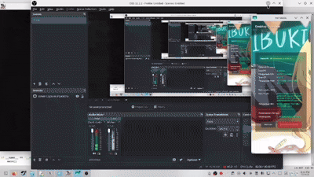

# taskmanager_pc_to_android

TaskManager PC to Android is an educational application that connects a PC and Android devices to monitor and manage tasks in real-time. Built with Python on the PC side and Kotlin Native on the Android side, featuring an interactive interface and clear task status information.

